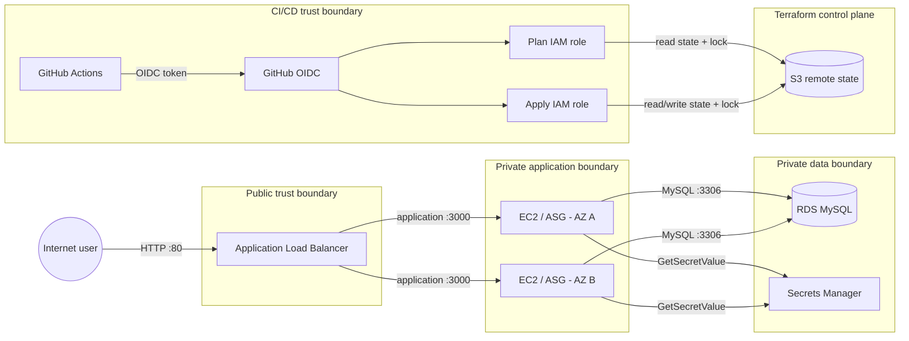

# Security Architecture and Risk Decisions

This document records the security model, automated controls, accepted risks, and production-hardening opportunities for the **Scalable AWS Web Application with Terraform** project.

It is intentionally more detailed than the main README. The goal is to make security decisions auditable: a reviewer should be able to distinguish controls that are implemented, findings that were fixed, and risks that were consciously accepted for a short-lived development/demo environment.

> [!IMPORTANT]
> The demonstration AWS environment has been intentionally torn down. This document describes the security architecture implemented by the Terraform and CI/CD code in this repository; it is not a claim that a live environment is currently running or being monitored.

## Contents

- [Security objectives](#security-objectives)
- [Trust boundaries](#trust-boundaries)
- [Security control matrix](#security-control-matrix)
- [Network security](#network-security)
- [Identity and access management](#identity-and-access-management)
- [Secrets management](#secrets-management)
- [Terraform state security](#terraform-state-security)
- [Compute hardening](#compute-hardening)
- [CI/CD security](#cicd-security)
- [Supply-chain security](#supply-chain-security)
- [Automated security gates](#automated-security-gates)
- [Trivy finding register](#trivy-finding-register)
- [Accepted risks](#accepted-risks)
- [Security verification](#security-verification)
- [If a secret is detected](#if-a-secret-is-detected)
- [Production hardening backlog](#production-hardening-backlog)
- [Security scope and limitations](#security-scope-and-limitations)

## Security objectives

The project is designed around the following security objectives:

1. **Minimize public exposure.** Only the Application Load Balancer is intentionally internet-facing.
2. **Keep compute and data tiers private.** Application EC2 instances and RDS run in private subnets.
3. **Use identity-based service access.** EC2 reads secrets through an IAM role rather than embedded AWS credentials.
4. **Avoid long-lived CI credentials.** GitHub Actions authenticates to AWS with OIDC and short-lived STS sessions.
5. **Separate read and write automation privileges.** Terraform plan and apply use different AWS IAM roles.
6. **Protect infrastructure state.** Terraform state is stored in a private, encrypted, versioned S3 bucket and accessed over TLS.
7. **Prevent accidental secret commits.** Gitleaks runs locally and in GitHub Actions.
8. **Block high-impact IaC mistakes.** Trivy fails on unreviewed HIGH and CRITICAL Terraform misconfigurations.
9. **Reduce CI supply-chain risk.** Third-party GitHub Actions are pinned to immutable commit SHAs.
10. **Document exceptions.** Security scanner suppressions are narrow and colocated with the resource that requires the exception.

## Trust boundaries



The primary boundaries are:

- **Internet -> ALB:** the external ingress boundary.
- **ALB -> application:** the public-to-private application boundary.
- **Application -> database:** the compute-to-data boundary.
- **Application -> Secrets Manager:** the workload-identity boundary for secret retrieval.
- **GitHub -> AWS:** the CI workload-identity boundary.
- **Terraform -> S3:** the infrastructure control-plane/state boundary.

## Security control matrix

| Domain | Control | Status | Notes |
| --- | --- | --- | --- |
| Public exposure | Only ALB is intentionally internet-facing | Implemented | EC2 and RDS remain private |
| Subnets | Public/private subnet separation across two AZs | Implemented | Auto public IP assignment disabled |
| Application ingress | ALB SG -> application SG only | Implemented | Application port is not exposed directly to the internet |
| Database ingress | Application SG -> RDS SG on `3306` | Implemented | No public database path |
| Database public access | `publicly_accessible = false` | Implemented | RDS is private |
| Database storage | RDS storage encryption | Implemented | `storage_encrypted = true` |
| Secret generation | Random password generated ephemerally | Implemented | Password is not persisted as a normal Terraform value |
| Secret storage | AWS Secrets Manager | Implemented | Application consumes a dedicated runtime secret |
| Workload IAM | EC2 role scoped to `secretsmanager:GetSecretValue` for the application secret | Implemented | Plus SSM managed instance policy |
| EC2 metadata | IMDSv2 required | Implemented | `http_tokens = "required"` |
| ALB hardening | Invalid header fields dropped | Implemented | `drop_invalid_header_fields = true` |
| CI AWS auth | GitHub OIDC / STS | Implemented | No static AWS keys required by workflows |
| CI privilege separation | Separate plan and apply roles | Implemented | Apply trust is tied to the `dev` environment |
| Terraform state | S3 versioning | Implemented | Protects against accidental state overwrites/deletes |
| Terraform state | SSE-S3 encryption | Implemented | CMK intentionally not used in development design |
| Terraform state | S3 public-access block | Implemented | Bucket is not public |
| Terraform state | Deny insecure transport | Implemented | Bucket policy denies non-TLS access |
| Terraform locking | Native S3 lock file | Implemented | `use_lockfile = true` |
| IaC scanning | Trivy HIGH/CRITICAL gate | Implemented | Local + CI |
| Secret scanning | Gitleaks | Implemented | Local + CI/history scan |
| GitHub Actions integrity | Full commit SHA pinning | Implemented | Reduces mutable-tag risk |
| Dependency updates | Dependabot for GitHub Actions | Implemented | Controlled update PRs |
| HTTPS | TLS termination at ALB | Not implemented | Accepted development risk |
| Database HA | RDS Multi-AZ | Not implemented | Availability trade-off, not a confidentiality control |
| Restricted egress | Fully allowlisted outbound destinations | Not implemented | Bootstrap currently needs internet egress |
| Customer-managed KMS | State/SNS CMKs | Not implemented | Accepted development trade-off |

## Network security

### Public and private subnet model

The VPC contains two public and two private subnets across two Availability Zones.

Both public and private subnet resources explicitly disable automatic public IPv4 assignment:

```hcl
map_public_ip_on_launch = false
```

A subnet is considered public because of its route to the Internet Gateway, not because every instance launched into it automatically receives a public IP address.

Application instances are placed in the private subnets by the Auto Scaling Group. Their outbound internet access is routed through NAT Gateways; they do not require inbound public connectivity.

### Application ingress

The ALB security group allows public HTTP ingress on port `80`.

The application security group does **not** expose the application port to the internet. It accepts application traffic only from the ALB security group:

```text
Internet
   |
   v
ALB :80
   |
   | SG reference
   v
EC2 :3000
```

The ALB egress rule and application ingress rule reference each other's security-group relationship rather than an arbitrary VPC CIDR.

### Database isolation

The RDS security group is not independently opened to a CIDR range.

The application tier receives an explicit egress rule to the database security group on MySQL `3306`, and the database security group receives the corresponding ingress rule from the application security group.

```text
EC2 application SG
       |
       | TCP 3306
       v
RDS database SG
```

RDS also uses:

```hcl
publicly_accessible = false
```

This means the database is not designed to have a public network path.

### Egress

The application tier currently permits outbound HTTP and HTTPS to `0.0.0.0/0`.

This is an **accepted development risk**, not an accidental rule. Instance bootstrap currently performs actions such as:

- OS package installation;
- AWS CLI installation;
- original application download;
- Node.js dependency installation;
- AWS API communication.

Restricting egress correctly would therefore require changing how the application artifact is built and delivered, not simply narrowing the security group and breaking bootstrap.

See [Accepted risks](#accepted-risks).

## Identity and access management

### EC2 workload identity

The application Launch Template attaches an EC2 instance profile.

Its project-specific inline policy grants:

```text
secretsmanager:GetSecretValue
```

only for the application database secret ARN supplied by the database module.

This is preferable to:

- embedding AWS access keys in user data;
- writing AWS credentials into application files;
- granting broad Secrets Manager read access.

The role also attaches `AmazonSSMManagedInstanceCore`, allowing Systems Manager-based management without opening SSH ingress.

### GitHub OIDC

GitHub Actions authenticates to AWS through an IAM OIDC provider for:

```text
https://token.actions.githubusercontent.com
```

with audience:

```text
sts.amazonaws.com
```

The workflows request:

```yaml
permissions:
  contents: read
  id-token: write
```

only in jobs that need an AWS OIDC token.

The static Terraform validation job and secret-scanning workflow do not need AWS credentials.

### Plan role

The plan role is intentionally read-oriented.

Its state permissions allow:

- `s3:ListBucket` on the state bucket;
- `s3:GetObject` on the Terraform state object;
- `GetObject`, `PutObject`, and `DeleteObject` on the `.tflock` file.

It does **not** receive `s3:PutObject` on the real Terraform state object.

This is an important separation: an authenticated plan can participate in state locking without being allowed to overwrite shared state.

The trust relationship is restricted to the repository's `main` branch subject.

### Apply role

The apply role has the infrastructure mutation permissions required by Terraform and state write access.

Its OIDC subject is scoped to:

```text
repo:flaviomurata/aws-scalable-web-app:environment:dev
```

This ties the role assumption to the protected GitHub Environment rather than granting the same trust to arbitrary repository contexts.

The role also narrows project-specific IAM changes to the application role and instance profile names used by this Terraform configuration.

## Secrets management

### Database password lifecycle

The internal RDS password is generated with Terraform's ephemeral random-password resource.

The password is written to Secrets Manager using write-only secret arguments and then read through an ephemeral Secrets Manager data source when required for RDS configuration.

This design reduces normal Terraform-state exposure compared with treating the plaintext database password as a conventional persistent Terraform value.

### Application secret

The original AWS Academy application expects a JSON secret with the following logical fields:

```json
{
  "user": "...",
  "password": "...",
  "host": "...",
  "db": "..."
}
```

Terraform creates that application-facing Secrets Manager secret from the generated database credential and the RDS endpoint.

The application retrieves it at instance bootstrap/runtime through its IAM role.

### No long-lived GitHub AWS secret

The CI/CD workflows do not require repository secrets such as:

```text
AWS_ACCESS_KEY_ID
AWS_SECRET_ACCESS_KEY
```

AWS authentication is federated through GitHub OIDC and STS.

## Terraform state security

Terraform state is sensitive infrastructure control-plane data even when application secrets are handled carefully. It can contain resource identifiers, topology, policy documents, and other operational information.

The bootstrap layer therefore creates a dedicated S3 backend with:

- bucket versioning;
- SSE-S3 encryption;
- public-access block;
- a bucket policy denying insecure transport;
- native S3 lock-file support.

The state bucket is kept outside the main Terraform state through a separate `bootstrap/` root. This avoids the circular dependency of attempting to store the backend in the state that depends on that backend.

### Plan/apply state permissions

The GitHub roles intentionally differ:

| Operation | Plan role | Apply role |
| --- | ---: | ---: |
| List state bucket | Yes | Yes |
| Read Terraform state | Yes | Yes |
| Write Terraform state | **No** | Yes |
| Read/write/delete lock file | Yes | Yes |

### Encryption decision

The state bucket uses SSE-S3 (`AES256`) rather than a customer-managed KMS key.

This was accepted for the short-lived single-account development environment because state remains encrypted at rest while avoiding additional KMS key-policy and role-policy complexity.

A production or regulated environment may reasonably require SSE-KMS with a customer-managed key.

## Compute hardening

### IMDSv2

The EC2 Launch Template requires Instance Metadata Service v2:

```hcl
metadata_options {
  http_endpoint               = "enabled"
  http_tokens                 = "required"
  http_put_response_hop_limit = 1
}
```

This prevents IMDSv1-style unauthenticated metadata requests and reduces the exposure of instance-role credentials to common SSRF-style metadata access paths.

### No SSH ingress

The Terraform application security group does not create an SSH ingress rule.

Systems Manager support is attached through `AmazonSSMManagedInstanceCore`, which provides an administrative path that does not require publicly exposing TCP `22`.

### Runtime user

The application service runs as the `ubuntu` user rather than root.

System bootstrap requires root privileges, but the long-running `systemd` unit starts the Node.js application under a non-root OS account.

## CI/CD security

### Least GitHub token permissions

Workflows declare job-level permissions instead of relying on broad defaults.

Examples:

- static analysis: `contents: read`;
- secret scan: `contents: read`;
- AWS-authenticated jobs: `contents: read` + `id-token: write`.

### Protected apply path

The deployment workflow is manually triggered and applies only from `main`.

The apply job targets the `dev` GitHub Environment. That environment can be configured with reviewer and branch protections, adding a human or policy gate before the apply-role OIDC subject becomes valid.

### Exact plan application

The apply job creates:

```text
tfplan
```

and then executes:

```bash
terraform apply -input=false -auto-approve tfplan
```

Applying a binary plan ensures the apply step acts on the exact plan produced in that job rather than recalculating an unconstrained plan at apply time.

## Supply-chain security

### GitHub Actions pinning

Third-party GitHub Actions are referenced by full commit SHA rather than mutable branch or version-tag references.

For readability, the intended release version remains in a trailing comment:

```yaml
uses: actions/checkout@<full-commit-sha> # vX.Y.Z
```

This protects a workflow run from silently receiving different action code merely because an upstream tag moved.

### Dependabot

`.github/dependabot.yml` enables the `github-actions` ecosystem on a weekly schedule.

The intended operating model is:

```text
immutable SHA today
        +
reviewed dependency-update PR later
```

rather than choosing between immutable references and maintainability.

### Original application artifact

The application bootstrap currently downloads the original AWS Academy application artifact dynamically.

That is adequate for preserving the lab application in this portfolio project, but it is **not** the strongest production software-supply-chain model.

A production design should build and version a controlled application artifact, verify its integrity/provenance, and deploy that artifact rather than relying on a runtime download.

## Automated security gates

### Local pre-commit / `prek`

The configured hooks include:

- Terraform formatting;
- Terraform validation;
- TFLint;
- Trivy;
- Gitleaks;
- YAML validation;
- typo detection;
- whitespace/end-of-file checks;
- large-file checks.

Trivy is configured to fail on:

```text
HIGH,CRITICAL
```

misconfigurations.

Gitleaks provides a local barrier against accidentally committing recognizable credentials.

### GitHub Actions

The security model contains two complementary pipelines:

```text
Terraform change
    |
    +--> fmt
    +--> validate
    +--> TFLint
    +--> Trivy
    +--> authenticated Terraform plan

Any repository change
    |
    +--> Gitleaks history scan
```

Secret scanning is deliberately not restricted to Terraform file extensions because secrets can appear in documentation, scripts, YAML, JSON, templates, or other files.

## Trivy finding register

The initial HIGH/CRITICAL Terraform scan identified eight findings.

The important security outcome was **not** "make the scanner show zero findings at any cost." Each finding was classified as:

- **FIX** — an actual weakness that could be removed without undermining the architecture;
- **ACCEPT** — an intentional design/development trade-off with a documented rationale;
- **DEFER** — a valid control that belongs in a production-hardening iteration.

| Trivy ID | Severity | Finding | Decision | Result / rationale |
| --- | --- | --- | --- | --- |
| `AWS-0052` | HIGH | ALB does not drop invalid headers | **FIX** | Added `drop_invalid_header_fields = true` |
| `AWS-0164` | HIGH | Public subnet auto-assigns public IPs | **FIX** | Set `map_public_ip_on_launch = false` |
| `AWS-0053` | HIGH | Load balancer is public | **ACCEPT** | Public ALB is the intentional internet ingress; application instances remain private |
| `AWS-0054` | CRITICAL | ALB listener uses HTTP | **DEFER / ACCEPT for demo** | Proper TLS requires a controlled DNS name + ACM certificate; production should terminate HTTPS |
| `AWS-0104` | CRITICAL | Application HTTP egress is unrestricted | **ACCEPT** | Bootstrap requires outbound package/artifact access through NAT |
| `AWS-0104` | CRITICAL | Application HTTPS egress is unrestricted | **ACCEPT** | Bootstrap/AWS API/dependency access currently requires HTTPS egress |
| `AWS-0132` | HIGH | State bucket does not use a customer-managed KMS key | **ACCEPT** | State is encrypted with SSE-S3; CMK deferred for development simplicity |
| `AWS-0095` | HIGH | SNS topic is not KMS encrypted | **ACCEPT / DEFER** | Topic carries operational alarm metadata; correct CloudWatch->SNS CMK design adds KMS policy complexity |

### Why inline suppressions are used

Accepted Trivy findings are suppressed beside the relevant Terraform resource:

```hcl
#trivy:ignore:AWS-0053
resource "aws_lb" "application" {
  # ...
}
```

This is preferred over a broad repository-wide ignore because:

- the exception is visible during code review;
- its scope is limited to one resource;
- future occurrences of the same rule elsewhere remain detectable;
- the code communicates that the exception is deliberate.

## Accepted risks

### HTTP-only public listener

**Risk:** browser-to-ALB traffic is not encrypted in transit.

**Why accepted for the demo:** the deployed lab used the AWS-generated ALB hostname and did not own a custom DNS name/certificate lifecycle.

**Production treatment:**

- create/manage DNS;
- issue an ACM certificate;
- add HTTPS listener on `443`;
- redirect HTTP `80` to HTTPS;
- consider HSTS.

### Public ALB

**Risk:** a public endpoint is reachable from the internet.

**Why accepted:** internet accessibility is a functional requirement of the application. The security objective is not to make the ALB private; it is to ensure the ALB is the **only** intended public application ingress.

**Production treatment:** retain the public ALB where required and add edge protections such as AWS WAF, rate controls, access logging, and stronger application-layer defenses as appropriate.

### Broad application HTTP/HTTPS egress

**Risk:** a compromised application host has broad outbound web access.

**Why accepted:** bootstrap dynamically installs and downloads software and talks to AWS APIs.

**Production treatment:**

- bake immutable AMIs or container images;
- move dependency resolution into CI;
- host controlled artifacts;
- use VPC endpoints for supported AWS services;
- introduce egress filtering/proxying where justified;
- remove HTTP egress if no longer required.

### SSE-S3 instead of a customer-managed KMS key

**Risk:** less direct control over key policy, lifecycle, and audit semantics than a CMK.

**Why accepted:** state is still encrypted at rest and the project was a single-account development environment.

**Production treatment:** use SSE-KMS with a customer-managed key where policy/compliance requirements justify it.

### Unencrypted SNS topic

**Risk:** SNS server-side encryption with a customer-managed key is not configured.

**Why accepted:** the topic contains operational alarm metadata rather than application/database payloads, and a correct CloudWatch-to-encrypted-SNS setup requires deliberate KMS permissions for service principals.

**Production treatment:** add a CMK and authorize the required CloudWatch/SNS KMS operations.

### Single-AZ RDS

This is primarily an **availability** risk rather than a confidentiality/integrity risk.

**Why accepted:** it lowers development/demo cost.

**Production treatment:** enable Multi-AZ and define backup/restore, retention, failover, maintenance, and disaster-recovery objectives.

### Immediate secret deletion and no final RDS snapshot

Development resources use teardown-friendly settings such as:

- `recovery_window_in_days = 0` for project Secrets Manager secrets;
- `skip_final_snapshot = true`;
- `deletion_protection = false`.

These choices support repeatable short-lived lab teardown but are inappropriate for important production data.

Production should normally use recovery windows, deletion protection, final snapshots/backup policy, and tested restore procedures.

## Security verification

The following checks are useful after deploying the project to a new account.

### Local static security

```bash
prek run --all-files
```

Or run the security tools directly:

```bash
trivy config \
  --severity HIGH,CRITICAL \
  --exit-code 1 \
  --skip-dirs '**/.terraform' \
  --tf-vars envs/dev/terraform.tfvars \
  .

gitleaks git --redact
```

### Verify no public application instances

```bash
aws ec2 describe-instances \
  --region sa-east-1 \
  --filters 'Name=tag:Project,Values=student-records' \
  --query 'Reservations[].Instances[].[InstanceId,PublicIpAddress,PrivateIpAddress,State.Name]' \
  --output table
```

Application instances should not require a public IPv4 address.

### Verify RDS is private and encrypted

```bash
aws rds describe-db-instances \
  --region sa-east-1 \
  --query 'DBInstances[?DBInstanceIdentifier==`student-records-dev-mysql`].[DBInstanceIdentifier,PubliclyAccessible,StorageEncrypted,MultiAZ]' \
  --output table
```

Expected security-relevant properties:

```text
PubliclyAccessible = false
StorageEncrypted   = true
```

`MultiAZ = false` is an explicitly documented development availability trade-off.

### Verify IMDSv2 enforcement

```bash
aws ec2 describe-launch-template-versions \
  --region sa-east-1 \
  --launch-template-id <launch-template-id> \
  --versions '$Latest' \
  --query 'LaunchTemplateVersions[0].LaunchTemplateData.MetadataOptions'
```

Expected:

```text
HttpTokens = required
```

### Verify GitHub OIDC roles

Check the trust policies:

```bash
aws iam get-role \
  --role-name student-records-github-plan \
  --query 'Role.AssumeRolePolicyDocument'

aws iam get-role \
  --role-name student-records-github-apply \
  --query 'Role.AssumeRolePolicyDocument'
```

Review:

- issuer/provider;
- audience;
- `sub` condition;
- branch/environment scope.

### Verify Terraform state bucket posture

For a recreated backend:

```bash
aws s3api get-public-access-block \
  --bucket <state-bucket>

aws s3api get-bucket-versioning \
  --bucket <state-bucket>

aws s3api get-bucket-encryption \
  --bucket <state-bucket>

aws s3api get-bucket-policy \
  --bucket <state-bucket>
```

Verify public access is blocked, versioning is enabled, encryption is configured, and insecure transport is denied.

## If a secret is detected

A leaked credential must be treated as compromised even if the line containing it is removed in a later commit.

Recommended response:

1. **Do not merely delete the secret from the latest file.**
2. Identify the credential type and affected account/service.
3. Revoke, rotate, or replace the credential immediately.
4. Determine whether the credential was pushed to a remote repository.
5. Review audit logs for suspicious use where available.
6. Replace the application/configuration path with a secret manager, OIDC, or another appropriate identity mechanism.
7. If warranted, rewrite Git history to remove the leaked material—but do this **after rotation**, because history rewriting does not make an exposed credential safe again.
8. Document the incident and prevention improvement.

The core principle is:

```text
rotate first -> investigate -> remove history if needed -> improve control
```

not:

```text
delete line -> assume secret is safe
```

## Production hardening backlog

The following controls would be reasonable next steps if this architecture were promoted beyond a portfolio/development environment.

| Priority | Improvement | Security value |
| --- | --- | --- |
| High | ACM HTTPS listener + HTTP redirect | Encrypt browser-to-ALB traffic |
| High | Immutable AMI/container artifact pipeline | Reduce runtime download and dependency risk |
| High | Controlled outbound egress | Reduce command-and-control/exfiltration paths |
| High | RDS deletion protection + backup/final snapshot policy | Protect data availability and recoverability |
| Medium | Multi-AZ RDS | Improve database availability |
| Medium | VPC endpoints for AWS services | Reduce dependency on public egress |
| Medium | ALB access logging | Improve incident investigation |
| Medium | VPC Flow Logs | Improve network visibility |
| Medium | Customer-managed KMS keys where justified | Stronger key-policy control/auditability |
| Medium | AWS WAF / rate controls | Reduce common public-web attack exposure |
| Medium | Centralized OS/application logs | Improve detection and investigation |
| Medium | Patch/AMI lifecycle policy | Make host updates reproducible |
| Low/Contextual | GuardDuty / Security Hub | Managed detection/posture features for longer-lived accounts |
| Low/Contextual | SCPs / multi-account separation | Stronger organizational guardrails at larger scale |

The backlog is intentionally prioritized by architectural value rather than by the number of scanner checks it would satisfy.

## Security scope and limitations

This project demonstrates infrastructure and delivery security practices, but it is **not** a complete application-security program.

The repository does not claim to provide:

- a formal penetration test;
- a secure software development lifecycle for the original AWS Academy Node.js application;
- application SAST/DAST coverage;
- dependency vulnerability management for the downloaded application;
- WAF-managed rule tuning;
- production incident response;
- continuous runtime threat detection;
- compliance certification;
- production backup/disaster-recovery guarantees.

Those omissions are explicit because a useful security document should make its boundary clear.

The strongest security property of this project is not that every possible control is enabled. It is that the implemented controls, exceptions, and limitations are **visible, reviewable, reproducible, and tied to concrete architecture decisions**.
